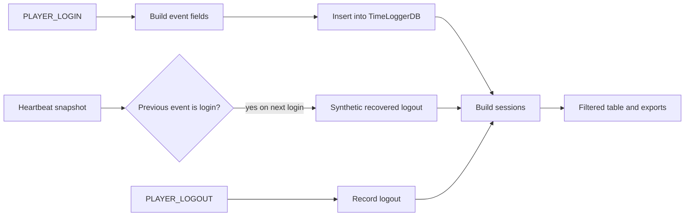

# Session model

TimeLogger stores raw `login` and `logout` events. The table and exports normally show sessions derived from those events, not the raw event list.

## Event-to-session flow

Events are grouped by character and realm. A login opens a session. A following logout closes it; a logout with `recovery = true` produces the `recovered` status.

## Session statuses

| Status | Meaning in the implementation |
|---|---|
| `open` | A login has no matching later logout. |
| `closed` | A login was paired with a normal logout. |
| `recovered` | A login was paired with a synthetic logout created from `temp_logout`. |
| `no_logout` | A second login arrived while a prior session for that character/realm was still open; the prior session is marked `no_logout`. |

The source does not document a separate pairing strategy for overlapping or out-of-order events. The implementation scans the chronological `event_order` and tracks one open session per character/realm key.

## Time semantics

- `unix` uses `GetServerTime()` when available and falls back to Lua `time()`.
- `utc` is formatted as an ISO 8601 UTC instant with a `Z` suffix.
- `local_dt` is formatted using the client-local date/time functions.
- `weekday` is normalized to ISO numbering: Monday `1` through Sunday `7`.
- A current open session's displayed duration is calculated from the current synchronized time.

## Recovery semantics

After login, the addon writes a temporary logout-shaped snapshot immediately and refreshes it on a configurable ticker. On the next login, if the latest stored event is a login and the snapshot is valid and earlier than now, the snapshot becomes a synthetic logout with `recovery = true`.

This is best-effort recovery. SavedVariables persistence is controlled by WoW; a crash before the latest snapshot is persisted can leave no usable recovery snapshot. The maximum age of a recovery point is approximately the heartbeat interval, subject to WoW save timing.

