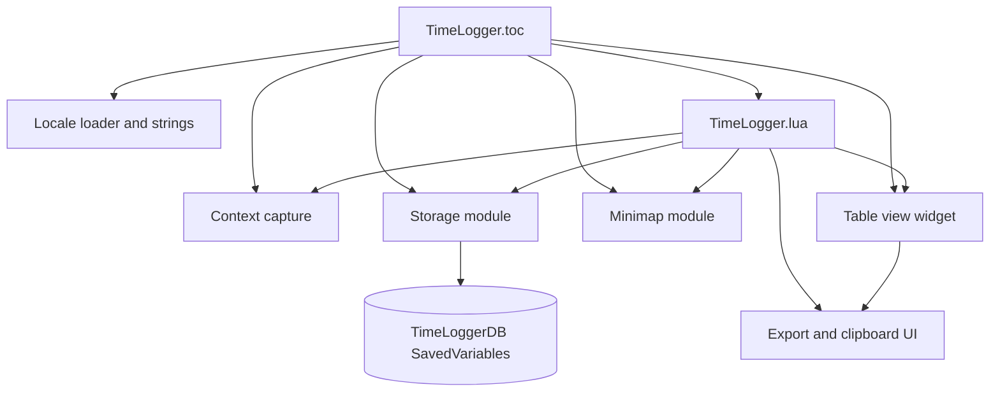

# Architecture

TimeLogger is a single-addon Lua application loaded in the order declared by `TimeLogger.toc`. It has no internal service process, network client, or external database.

## Responsibilities

- `TimeLogger.lua` is the application shell: WoW event handlers, event-field assembly, recovery ticker, export serialization, slash commands, UI creation, pruning, restore, and playtime refresh.
- `TimeLoggerStorage.lua` owns the structured SavedVariables database, schema migration, indexes, cached sessions, backup snapshot, and playtime values.
- `TimeLoggerContext.lua` isolates WoW metadata collection so event assembly does not own patch, expansion, location, weekday, subscription, and local-time logic.
- `TimeLoggerTableView.lua` is a reusable UI widget with per-column substring filters, horizontal/vertical scrolling, and a pooled row renderer.
- `TimeLoggerMinimap.lua` owns the draggable launcher and persisted minimap settings.
- `TimeLoggerLocale.lua` provides locale resolution, fallback, string lookup, and display formatting. The two files in `Locales/` provide base English and overlays.

## Main boundaries

The storage module exposes a small object-like API through the global `TimeLoggerStorage`; the rest of the addon should use that API rather than mutating `TimeLoggerDB` directly. The UI consumes event/session row projections built by `TimeLogger.lua`, not raw database tables.

The addon has no authentication or authorization layer. Data is local to the WoW account's SavedVariables and is not sent to a service by the source in this repository.

## Extension points and constraints

New captured fields must be considered in event construction, storage copying/migration behavior, UI columns, and serializers. New session states must be coordinated between `BuildSessions`, locale formatters, table columns, and export consumers. WoW API availability and SavedVariables save timing are external constraints.

